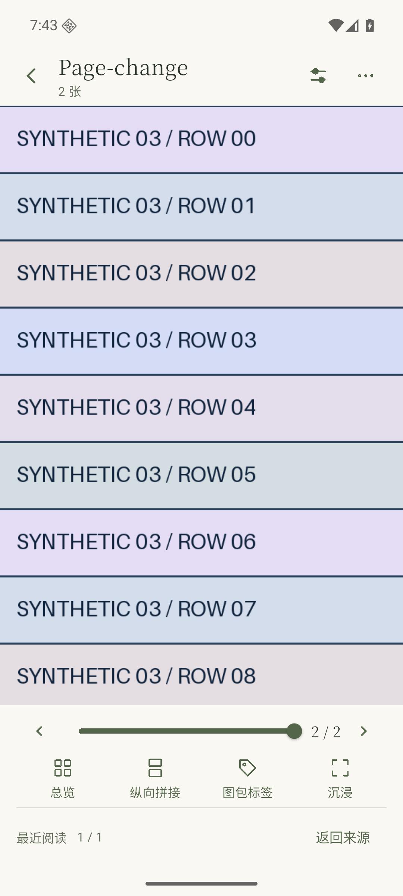
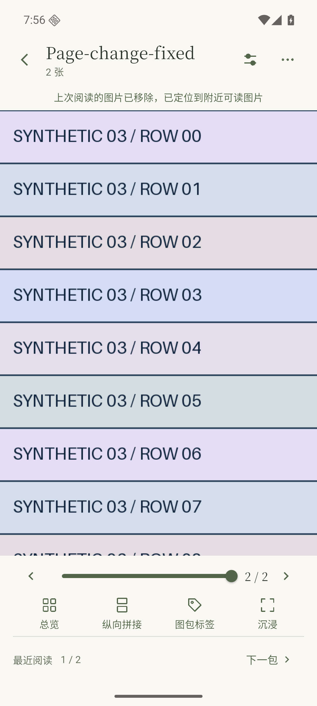

# 第28版 App 已交付

NAS 原部署目录 `packages/` 已提供：

- `video-viewer-0.2.0-preview.22-arm64.apk`：正常包，内部版本28。
- `video-viewer-0.1.4-rollback.22-arm64.apk`：旧视频界面，同号回退包。

直接覆盖安装，不要卸载或清除数据。沿用原Windows签名、包名、地址和口令。需要回退界面时用同号rollback.22；较低版本一般不能直接覆盖。第27版两包及原说明保留。

本次修复 [#170](https://github.com/ShiJiJS/video_viewer/issues/170)：上次阅读的图片被移除或不可读时，打开附近有效图片后保留定位说明。此前打开回执过早清掉了提示，图片本身已经正确定位。提示在当前阅读页面保留，切换图包时重新计算；没有修改服务端续读、标签或文件操作。

固定源码 `fc564a96f7a1b2b8c7cf46554777bb2a1ea971f8`，纳入[整体草稿PR #168](https://github.com/ShiJiJS/video_viewer/pull/168)。新增两项检查在旧代码均失败，修复后21项阅读会话、服务适配和阅读组件相关检查通过。正常/回退包均完成分析、构建兼容检查与原Windows签名校验，使用正常main、ARM64，不含集成测试插件或参考原型。

## 实际画面对照

普通第27版与第28版各使用一份新建测试图包，三张长图字节相同，图包和图片ID独立。通过API预置第二张45%位置后，两版均实际打开到该图片。关闭App后只移除自生成的第二张，等待正常稳定期并显式扫描一次，再由新App进程从最近进入。两版均定位到原第三张开头；第27版缺提示，第28版可见提示，返回最近的位置正确。每个样本内部均在相同Android启动中核对新旧App进程；构建期间模拟器主动停止，不将跨版本过程声称为同一次启动。

| 第27版：缺少说明 | 第28版：说明可见 |
| --- | --- |
|  |  |

第28版覆盖安装保留应用身份、首次安装时间、数据目录及连接；剩余两张的原ID和字节、图包标签和阅读偏好保持。仅使用本机合成资料，未以真实收藏做删除试验。不可读原因另由新增会话检查覆盖；上述原生画面只证明图片被移除的样本。此项不等于完整45项验收，实体手机声音、手势与性能条件仍保留。

后续仅补组件检查：390×844普通字号、360×740双倍字号、844×390短横屏均真实解码测试资源，服务打开回执清除标记后定位说明仍在屏内，图片区域和返回按钮可用，实际点击返回来源。新增3项与既有阅读会话/阅读组件合计15项通过，测试文件分析和格式通过。早期测试在路由进入布局前读取状态而失败，已等待路由实际出现后核对，未修改产品布局。此补充不产生新APK，也不作为新的原生或实体手机证明。

## 安装包

| 安装包 | 字节 | SHA256 |
| --- | ---: | --- |
| 0.2.0-preview.22 | 23308182 | `937f40a6bd9f67000d5726e3ed58ef1044da4999bf9b45b134503d9f21fad67d` |
| 0.1.4-rollback.22 | 21734394 | `3f7dc9af067080af1eefba5cddeaa6c16fd676ec91032de0b47873df11ef7c6c` |

NAS两份文件与本机构建一致。服务继续为[preview.8](nas-preview-2026-11-01-service8.md)，容器身份、启动时间和重启次数保持，健康正常。本次只复制APK和说明，未登录业务、访问NAS数据库/媒体、重启或迁移。原备份保持。

本次临时容器、代理、专用模拟器、合成图片、配置及构建导出已清理；SDK/JDK、原签名、常用模拟器、安装包和小型检查记录保留。原型继续独立可移除，未合并草稿或正式发布。
