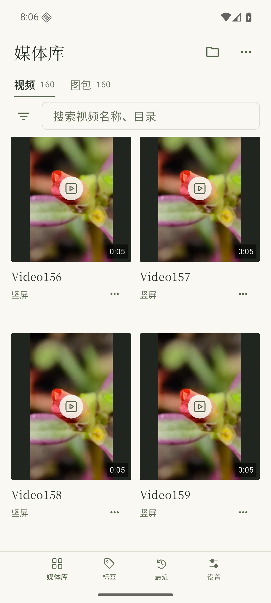
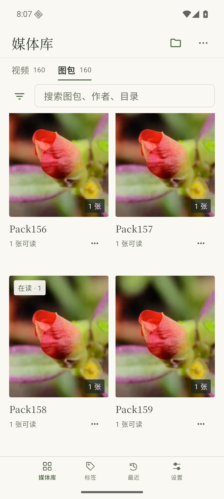

# 第28版长列表返回核对

2026-11-01，承接[#133](https://github.com/ShiJiJS/shika/issues/133)的R5及NAV-02/LIB-03。使用已交付普通preview.22/code28、正常入口、源码fc564a96及NAS同版服务preview.8的本机独立容器；没有修改App、服务、原型或安装包。

从公开素材独立复制160个视频和160个单页图包，保留默认2秒稳定期，显式扫描一次。通过真实Android滑动分别越过120项窗口，打开Video158和Pack158（均为第159/160项），实际视频画面/图片显示后系统返回。两种来源卡片打开前后边界均为[44,1326][523,2144]，顶部差0像素，分类与原列表保持。然后各向前滑动6次，实际读回较早页面并显示112–117项，HTTP记录包含120、96偏移的读取。

[精简结果](../../assets/deep-catalog-code28/result.json)记录对应ID、偏移和位置。两类最近各仅1项，均为实际打开的158项；320份源副本SHA保持。只有登录、创建视频/图包范围及实际打开的写请求，没有删除、恢复、设置修改或新扫描。App正常初始化的回收站数量GET是只读查询；首次离线复核误将其归为写入，已按HTTP方法修正后核对既有记录，没有重演操作。

| 视频返回 | 图包返回 |
| --- | --- |
|  |  |

本次只补媒体库的当前普通包长列表返回与向前分页路径，不等于标签/最近深列表、故障重试、真实手机性能或完整45项验收。复用已有控制器/组件检查，未重复全套测试、生成新APK或访问NAS。声音关闭，不作为有声播放证据。

专用容器、代理、模拟器、合成副本与配置已清理，原四个服务健康、常用AVD配置保持；SDK/JDK、原签名、已交付包、备份和小型本机记录保留。整体草稿仍为[#168](https://github.com/ShiJiJS/shika/pull/168)，未合并或正式发布。
