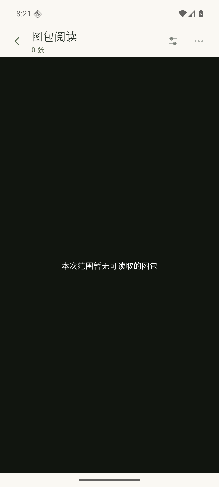

# 第28版阅读范围与不可用图包

2026-11-01，承接[#133](https://github.com/ShiJiJS/video_viewer/issues/133)的R4、READ-05及相关PKG-02/SET-04。使用已交付普通preview.22/code28、正常入口、App源码fc564a96与本机独立服务preview.8（2de02374）。生产程序、原型和安装包未改。

## 实际操作

新建三份范围内公开样本ScopeA/B/C及独立根的OutsideD。本机夹具仅关闭自动扫描，保留默认稳定期。App在媒体库搜索Scope，明确点击A；服务固定范围正好3成员，不含D。仅将自生成B移出已配置根，等待默认2秒稳定期并显式扫描一次。App旧下一包仍指B时返回422，画面留A并显示重新读取位置；明确重读后下一包转到原C，范围身份/3个候选保持，队列可用性为真/假/真。

随后通过准备API停用范围内根，D所在根继续启用且D仍可浏览。App更多菜单的旧上一包请求返回422，明确重读后显示“本次范围暂无可读取的图包”；点击返回来源，原Scope搜索仍在，显示0个结果，没有打开D或新建全库范围。

重新启用该根后，A/C标签和原阅读位置、B缺失身份与标签保持，最近去重仅A/C，四份源副本SHA保持。B只是移到本机测试根以外，没有删除图片。App没有发出根编辑、扫描、删除或恢复命令；这些根状态变更和一次重扫均为准备操作。

[精简结果](../../assets/reader-scope-code28/result.json)保存固定身份、可用性和三次切包状态422/200/422。三个切包请求各一次、请求ID独立，只有一份创建范围；实际图片打开确认为A、重读后的A、C，均在原范围中。首次离线复核遗漏了明确重读A后的第二次打开确认，修正后核对既有请求通过，没有重演业务操作或将其称为自动重放切包。

| 缺失B后，仍在原范围打开C | 全部停用后，原范围为空 |
| --- | --- |
|  |  |

本次不等于全部离线/唯一改名/空文件夹、标签或最近来源、目标手机/NAS和完整45项验收。读取/身份逻辑已有服务检查，此次补普通安装包的明确操作路径，没有重复服务全集、再打包或访问NAS。

专用容器、代理、模拟器、合成资料和配置已清理；原四服务健康、常用AVD、SDK/JDK、原签名、安装包及备份保持。整体草稿仍为[#168](https://github.com/ShiJiJS/video_viewer/pull/168)，未合并或正式发布。
