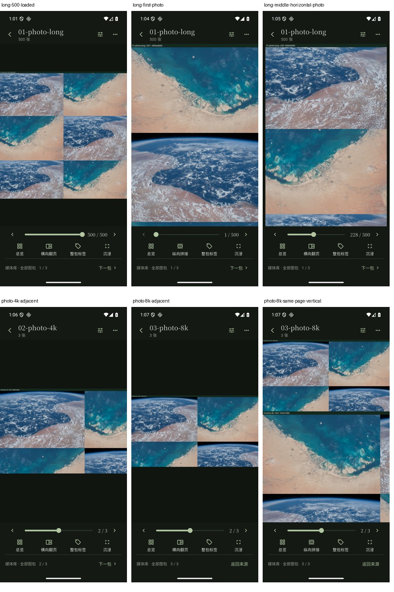

# 普通安装包：选定大图页面与返回

冻结4dd88cac的普通release `lib/main.dart`，实际安装APK SHA见上层构建/安装证据，未使用profile或integration_test入口。沿用当前自有AVD QEMU61904的host GPU比较配置，普通服务入口/固定镜像、只读506页夹具不变。通过真实连接表单从升级实验8772切换到大图实验8773，这一步使用独立测试登录；不能称整个阶段零登录。

已检查10个实际图片状态：[result.json](result.json)。500页包从已有500页记录继续，末页横向照片呈现；随后检查首页、228页纵向→同页横向、229页相邻图片。再在固定三包范围进入4K包的第1/2张、8K包的第1/2张，8K第2张切纵向仍为同页，最后Android返回原三包媒体库。4K样本含4000×6000/6000×4000，8K首次为8000×8000（6400万像素）、相邻为7680×4320。没有把“文件列出500页”当成普通APK遍历500页；完整三轮遍历/性能仍是81a11a98的独立profile证据。

原始PNG/XML/前台窗口保留，图片像素丰富度只作等待加载完成的辅助，不代替人工看图。十个图片结果已实际查看，精选六图汇总如下；原图不裁切或修改，汇总图仅缩放并排。

完整337条请求窗口含一次空视频库的playback 404，以及两次图片GET 503；全部保留，不称“所有请求都成功”。两个图片路径分别在0.460/0.625秒后GET 200，后续照片已呈现。代码既有图片400/800ms有限读取重试，本段没有自动重发写操作或修改重试策略。503响应正文未采集，不能只凭状态码断言具体原因；服务存在image_busy保护。见[请求窗口](requests-window.jsonl)和result中的失败/后续成功配对。

506份原素材全部重新读取SHA和字节数，3,423,051,928字节与原manifest一致。素材是两张NASA/JSC公开摄影像素裁切/拼接生成的压力样本，并非506张独立照片；来源与完整清单沿用[性能证据](../../lf8-reader-performance/README.md)。没有读取真实SMB收藏。

[manifest.json](manifest.json) 固定113份输入和汇总，不含本说明/清单自身；保留全部UI XML/窗口，只公开十个图片PNG及连接/列表/返回三个结果PNG，其余点击前原PNG私有保留。这个选页检查不关闭#78/#89/#100，也不替代实际手机/NAS性能、持续稳定性和整个产品验收。
