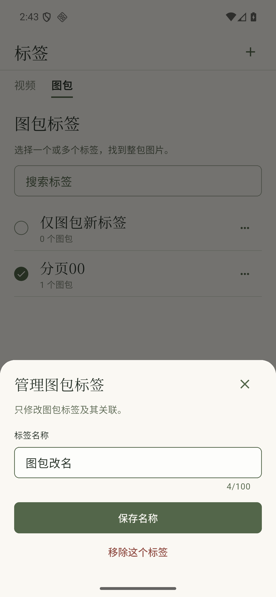
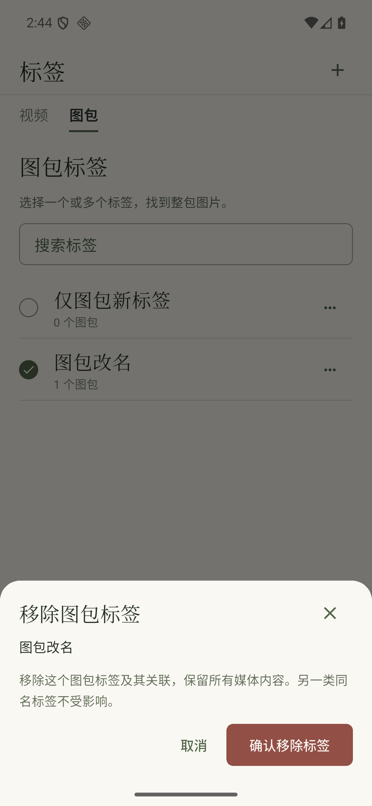
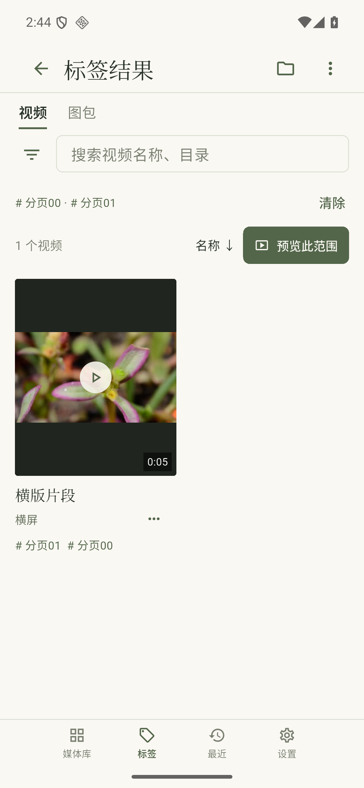

# LF8：两套标签目录与定义编辑

基于PR #72／7e366e9，生产客户端固定`4e905aa`。普通完整取证脚本`2cde25c`；大字目录／表单使用`4e905aa`已通过记录，横屏使用`c7e9799`已通过记录；两组结果专项补充为`79de2d9`。所有正式组的完整客户端lib与服务生产文件逐字节一致，脚本各自保留实际提交，不声称同一脚本／同一次夹具贯穿所有点。冻结原型树`1cbf605af8f03fa067a4ce8e914bb809e3a487ca`独立未改且可移除。实现范围见[设计约束](../../LF8-TAG-MANAGEMENT.md)。

标签目录保留按类型独立的搜索／选择、AND计数、媒体库结果和视频预览入口、50项读取与更多标签。统一20dp正文锚线、20dp衬线名称、65dp最小开放行、12dp计数和20dp描边勾选标记；次级文案使用现有Paper目录次级色。读取失败保留列表与跨页选择，仍从失败的offset重试。

新建／改名复用PaperField外置标签与近白输入面，13dp类型范围说明、16dp输入和明确的“创建标签／保存名称”；短面板动作普通固定、极短可滚。必填及100字限制、失败草稿、当前类型与危险移除明确。编辑错误独立于目录错误，修正旧版把一次同名错误重复显示到背景目录的问题。写入中不能重复提交或关闭，旧回调与确认期间连接身份改变不能将旧ID提交到新连接。

移除在同一面板切换为独立确认步骤，保留名称、当前类型、只删关联不删内容及另一类型同名不受影响；取消回到原编辑草稿。初版叠了两个sheet，按独立评审唯一提升收敛为一个层级，未换字体／色板／全局骨架。沿用现有面板240ms、按钮反馈和加载，无装饰动效；没有用静态图认证完整动效或手势。

## 原生界面速览

| 编辑图包标签 | 单层移除确认 | 交集结果 |
| --- | --- | --- |
|  |  |  |

## 实际流程与覆盖

正式证据共45点：普通`normal/`完整15点；大字`large/`和横屏`landscape/`各保留已通过的13个目录／表单／分页点，旧结果标题门槛的第14图不计；`large-results/`与`landscape-results/`各独立补2个真实结果失败／重试成功点。后两组重新通过实际标签入口选择两个条件，使用各自新准备的夹具，不把不同夹具ID或SQL前后跨组拼接。

390×844普通、360×740双倍字号、844×390短横屏，DPR3。目录／表单组覆盖视频两标签交集、图包同名隔离、目录暗色、真实IME新建、同名409保草稿、成功创建、改名编辑浅暗／成功、移除确认／取消／再次明确提交、跨50项503保留／同offset重试。结果专项使用同一生产代码，单独检查503、实际点击重试、唯一成员ID／total=1／两个筛选条件；在短高度揭示卡片标题后取成功图；横屏封面上部离屏，成功图不认证整张封面同时可见。暗色覆盖目录和改名面板，不外推全部状态。正式组继续使用host，失败的软件渲染尝试另归诊断，不计最终点。

每轮通过公开API准备27包81张图片、27份视频源和61个视频标签；视频首标签关联2项、次标签关联其中1项，同名图包标签关联1包。准备写入单独与UI阶段区分，不称整个过程只读。目录／表单组的UI阶段图包定义只有四次写尝试：同名创建409、改名草稿后创建201、原ID改名200、原ID删除200。取消确认不写，改名前／后ID与关联相同；删除后仅此图包定义／关联移除，新增零关联标签保留。61个视频定义与3条原关联完全相等，同名视频标签不受影响；SQL交集恰为1。结果专项从首个错误检查点到成功只有读取，零新增UI写；其准备写入另列。视频定义的真实UI创建／改名／删除和批量追加等其它组合仍需继续，组件仅证明共享界面的相应分发。

每点保存原始PNG、前台窗口、实际窗口／字号／IME／主题日志、请求、81图片源SHA与独立有界SQL投影。各点图片SHA相同，视频前后27份路径／大小／SHA相同；完整playback响应前后相等，UI阶段没有播放轮次或文件操作写入。该播放接口只返回当前窗口，不把窗口响应冒称27候选逐项清单。进入标签结果同时核对真实GET两个条件、SQL交集，以及当前实际VideoCatalog状态的唯一成员ID、total=1和error为空；503后实际点击重试再读取，保留错误／成功两张图，不以标题代替成功结果或用已加载数量冒称全范围。

每轮恢复原1080×2400／420dpi／font1.0；固定视口不能冒充实际旋转。仅8761公开可丢弃夹具，未改正式8760／NAS／SDK或发布APK。MemoryCredentialStore不作为安全存储或强停证明。服务生产代码未变；e2e仅增加测试控制端的有界SQL投影与请求摘要，不增加生产API。

## 检查、参考与诊断

`checks/`为46项相关客户端检查连续三轮、analyze、6个变更Dart文件格式和Ruff。13个新增表单检查包含两类型×四种真实字号／尺寸及模拟IME、失败草稿、单一确认层、重复提交、关闭门槛与身份变化。不是客户端／服务端全集。`checks/source.json`保存整个test树的输入快照；实际只执行列明六文件46项，快照不作为其它测试的覆盖证明；各组原生`source.json`固定实际源码与e2e边界；根`source.json`为普通完整组，不代替其它组的脚本来源。

`reference/`为真实浏览器390×844的五种冻结状态、DOM测量及13份HTML/CSS/JS的本地与实际HTTP SHA核对。面板等待字体与过渡稳定后取图。参考与原生不共用真实系统安全区，数据名称／数量不同，不能以整图绝对Y或面板总高替代字号／行高／锚线对照。外置字段标签及必要100字计数按已有管理表单保留。

`review/`保留独立存量首轮及六次复核，共7份静态报告；不打分，不重新探索。最终普通15图复核，大字／横屏各新增2图复核；13核心图沿此前亲看、字节未变的结论，不称再次重跑。首轮普通12图中改名编辑原生证据缺失，最终增加浅暗两图补齐。只认证对应可见外观，静态图不认证滚动可达、提交协议或手势／动效。

`baseline-partial/`固定088d6f9：只有旧目录／暗色／键盘四个状态及错误图。脚本等待“已有同名标签”，实际服务为“已有同名图包标签”，超时；草稿实际保留，不能称成功完整基线。`intermediate-input-delivery/`固定8bdfe2d：第二次编辑后再次收到409，错误图仍显示旧值；该轮未记录正文，不能仅凭旧日志确认实际提交值。脚本改为重新聚焦、等待控制器实际值并在隐藏IME后核对，未以重跑掩盖该失败。`intermediate-before-single-panel/`与大字中间组固定6122700，12点完整通过，但保留双层移除面板及缺少两张编辑图，不能代替最终证据。

`diagnostics/landscape-before-ready-wait/`为6122700旧横屏脚本：寻找首个惰性标签行失败且没有初次状态图；随后加入实际成员读就绪等待，所有滚动定位异常也会取错误图。`landscape-loaded-but-unmounted/`表明即使数据加载，通用滚动定位仍未找到短视口惰性行；最终明确滚动标签正文CustomScrollView，并记录实际可滚动区域，未因此修改生产布局。旧首轮日志不足以单独确认根因。`diagnostics/`还保留初次RawTooltip误当IconButton、旧确认层测试未更新、初次analyze问题等；这些失败均不计最终通过。

本段补TAG-01/02与UI-01/04/05的明确组合，整体验收仍开放。视频定义真实CRUD、批量追加／完整范围与更多失败来源组合、备份故障／大文件／系统选择器、预览／阅读其它异常及手势、500页4K/8K与目标手机／NAS／原签名继续；需配合部分按授权暂跳过。backup_v2生产仍关闭，#24/#33保持开放。

仓库根运行`python3 docs/plans/library-first/evidence/lf8-tag-management/verify.py`，只读核对45点、真实条件／请求、SQL定义与关联、源SHA／播放响应、窗口、设备恢复、生产字节一致、每组实际脚本提交及所有manifest输入。后续生产改变应在本阶段提交复核，不把历史通过外推到新HEAD。

`intermediate-single-panel-{normal,large}/`与`intermediate-result-title-only-{normal,landscape}/`保留旧14点通过记录，但原结果检查只看标题；独立横屏复核发现实际为连接错误页，不能作为结果成功的证明。最终脚本加入实际成员、总数、查询条件和独立错误／重试帧。`diagnostics/result-fault-without-epoch/`是新故障控制初轮：夹具提前返回503但遗漏管理代次响应头，客户端显示身份错误而精确错误检查超时；最终仅测试夹具按数据库当前代次返回响应头，不改正式协议。以上中间记录均不计45个最终点。

`diagnostics/emulator-exited/`与runner日志保留一次QEMU退出／adb设备消失、测试未完成和恢复失败；没有据此推断GPU或其它根因。按本仓库macOS流程重启同一AVD，未wipe、卸载或重置用户数据；`emulator-restored.json`和启动日志记录boot_completed、设置服务及原显示参数，后续每轮再核对恢复。

`diagnostics/strict-results-before-transport-diagnostic/`为2cde25c普通轮次：严格结果检查超时，界面为网络错误，结果24项请求未出现在服务trace；不能归因为前一轮已修正的代次头。随后`transport-debug-repeat/`临时增加debug assert输出底层IOException，完整15点通过且无该异常输出，未复现原连接问题，根因仍未确定。该组保存临时diff，source.json含这一个未提交调试文件的实际SHA，不作为固定提交取证；临时代码已逐字节移除，普通完整组与两种尺寸结果专项另取正式证据，未将诊断轮计入45点。

`diagnostics/emulator-exited-during-large/`为2cde25c第二轮大字中断：已有5个状态，模拟器进程退出139且adb设备消失，Flutter未完成，显示恢复失败。其启动日志同时有bad color buffer及QEMU线程挂起提示，不把这些提示当作已证实根因。按同样host/Vulkan关闭参数重启同AVD，`emulator-restored2.json`再次记录boot、系统服务及原显示恢复；保留普通已通过15点；后续重复完整大字仍退出，最终按下述分组补结果专项。未wipe、卸载、改AVD后端默认值或其它用户进程。

`diagnostics/emulator-exited-during-large2/`记录第二个新启动host轮次在相同5点之后又退出139，仍不据日志推断确定根因。随后仅测试进程改用`-gpu swiftshader`，不改启动脚本／AVD默认值，保留显示重置与实际启动日志；这是一项临时取证环境差异。旧开发文档中的软件渲染曾在其它视频流程挂起，因此本段也不外推它对全部播放流程适用。

软件模式的`software-launcher-anr/`首个截图被NexusLauncher无响应窗遮挡，host controller明确拒绝；App测试随后因真实IME超时失败。关闭该测试启动器后仍见SystemUI无响应窗，因此正常退出软件AVD并恢复host，未把软件轮次计入正式结果。重复完整流程不再作为取得相同表单画面的条件；保存已有生产字节相同的13点核心证据，并用79de2d9的`--tag-results-only`分开补齐结果状态。没有删除或改写旧失败／弱门槛日志。
